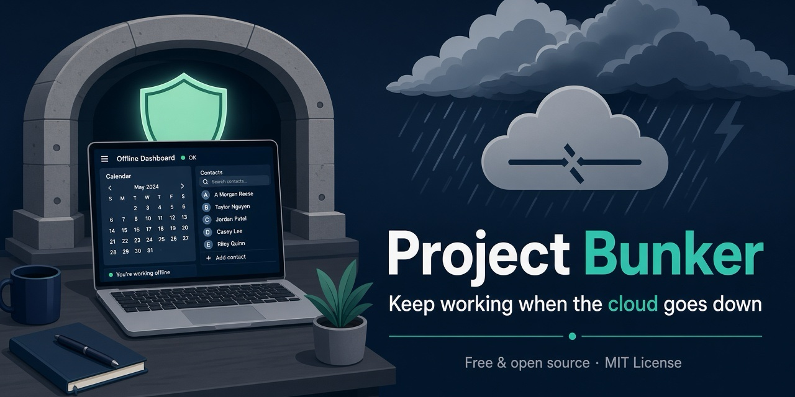
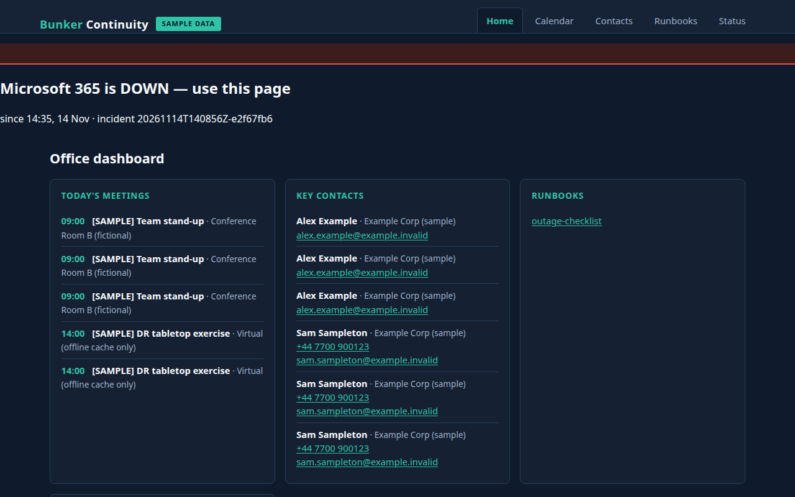
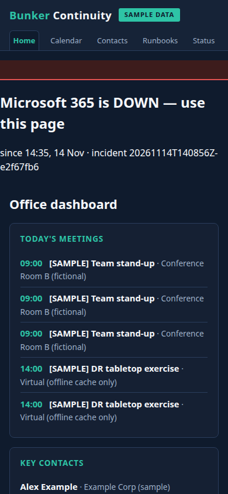

<p align="center"></p>

# Project Bunker

[](https://github.com/tgollogly/project-bunker/actions/workflows/ci.yml)


_Project Bunker is an independent, free, open-source project. It is not affiliated with, endorsed by, or sponsored by Microsoft, The Bunker, Bunker Technical Solutions, or any other company. Microsoft 365, Outlook, Teams and SharePoint are trademarks of Microsoft Corporation._

```
 ██████╗ ██╗   ██╗███╗   ██╗██╗  ██╗███████╗██████╗
 ██╔══██╗██║   ██║████╗  ██║██║ ██╔╝██╔════╝██╔══██╗
 ██████╔╝██║   ██║██╔██╗ ██║█████╔╝ █████╗  ██████╔╝
 ██╔══██╗██║   ██║██║╚██╗██║██╔═██╗ ██╔══╝  ██╔══██╗
 ██████╔╝╚██████╔╝██║ ╚████║██║  ██╗███████╗████████╗
 ╚═════╝  ╚═════╝ ╚═╝  ╚═══╝╚═╝  ╚═╝╚══════╝╚═════╝
   Bunker Continuity — when Microsoft 365 goes dark
```

**Bunker Continuity** (built on Project Bunker v0.3) helps a **small organisation keep working** when **Microsoft 365** (Outlook, Teams, Exchange Online) is unavailable — as in the long global outage of **12–14 November 2026**.

It does **not** replace email or Teams. It keeps **schedules, contacts, runbook documents, backup chat, and signed offline bundles** on premises.

---

## Why this exists

When M365 is down for 24+ hours:

- Staff still need **today’s meetings** and **who to call**.
- Incident leads need **runbooks** without SharePoint.
- You need a **fallback channel** that does not depend on Microsoft’s status page loading.

Bunker:

1. **Snapshots** Graph data (calendar 14d, contacts, configured SharePoint folders) into **local Parquet + files**.
2. **`bunker watch`** tracks reachability (Outlook/Teams URLs + optional Graph service health) with **OK / DEGRADED / DOWN** and hysteresis.
3. On **DOWN**, writes a **local incident** and alerts **Matrix** (optional) + **SMS** (stub/Twilio) + **HMAC-signed LAN UDP**.
4. **`bunker serve`** — offline FastAPI web UI on loopback (Jinja2 autoescape, no CDN). Use `bunker serve set-password` before binding to a LAN address.
5. **`bunker sync-package`** — **Ed25519-signed** bundles for USB/LAN site transfer (see [Core Bunker engine](docs/core-engine.md)).

See also [Testing on an M365 Developer tenant](docs/real-tenant-test.md).

---

## Honest limitations

| Claim | Reality |
|-------|---------|
| Replaces Outlook/Teams | **No** — backup visibility + chat only |
| Full P2P mesh | **No** — signed folder handoff + `import-sync` |
| Matrix “production” | **Docker profile** for Conduit + Element — you must configure users/rooms |
| Graph sync | Requires **Azure app** or token via env; tests use **mocks only** |
| Email archive | **Not implemented** |

See [SECURITY.md](SECURITY.md) for UK GDPR and Graph permissions.

---

## Microsoft Graph permissions (least privilege)

| Permission | Purpose |
|------------|---------|
| `Calendars.Read` | Calendar view snapshot |
| `Contacts.Read` | Contact / address list |
| `Files.Read.All` or `Sites.Read.All` | Configured runbook libraries |
| `ServiceHealth.Read.All` | Optional health signal for `bunker watch` |

Use a dedicated app registration with admin consent; store secrets in environment variables only.

---

## Environment variables

| Variable | Purpose |
|----------|---------|
| `BUNKER_GRAPH_TENANT_ID`, `CLIENT_ID`, `CLIENT_SECRET` | App-only Graph |
| `BUNKER_GRAPH_ACCESS_TOKEN` | Tests / delegated token (no MSAL) |
| `BUNKER_DATA_KEY` | Fernet encrypt continuity Parquet/docs/meta (44-char key or passphrase + salt) |
| `BUNKER_DATA_KEY_NEW` | New key for `bunker continuity rekey` |
| `BUNKER_MATRIX_ACCESS_TOKEN`, `BUNKER_MATRIX_HOMESERVER` | Matrix alerts |
| `BUNKER_MESH_KEY` | HMAC LAN UDP alerts (16+ bytes) |
| Twilio suite | `BUNKER_TWILIO_*`, `BUNKER_SMS_TO` |
| `BUNKER_SP_DRIVE_ID` | SharePoint runbook drive in `config/continuity.yaml` |

---

## Quick start

```bash
make init
bunker keygen
export BUNKER_GRAPH_ACCESS_TOKEN=...   # or app-only Graph env vars
bunker doctor
bunker continuity sync
bunker continuity status
bunker watch
bunker serve --port 8765
```

### Try it in 2 minutes with sample data (no Microsoft account needed)

```bash
make init
export BUNKER_DATA_KEY=0123456789abcdef0123456789abcdef   # demo Fernet key
bunker keygen
bunker continuity seed-sample    # fictional calendar, contacts, runbook
bunker continuity status         # should list m365_calendar, contacts, docs
bash scripts/continuity-outage-demo.sh
bunker serve --port 8765           # open http://127.0.0.1:8765 — watch DOWN + Sam Sampleton
```

### What it looks like

*(sample data, simulated outage)*

| Desktop (1280×800) | Mobile (390×844) |
|-------------------|------------------|
|  |  |

**Outage demo (simulated probes):**

```bash
bash scripts/continuity-outage-demo.sh
```

**Matrix (optional):**

```bash
docker compose -f docker-compose.continuity.yml --profile matrix up -d
```

---

The open-data ingest engine (DuckDB, signed sync bundles) is documented in [docs/core-engine.md](docs/core-engine.md).

---

## Development

```bash
make test
make lint
make typecheck
```

---

## Trademarks and affiliation

Project Bunker is an independent, free, open-source project. It is not affiliated with, endorsed by, or sponsored by Microsoft, The Bunker, Bunker Technical Solutions, or any other company. Microsoft 365, Outlook, Teams and SharePoint are trademarks of Microsoft Corporation.

---

## License

Project Bunker is released under the [MIT License](LICENSE) (Copyright (c) 2026 Thomas Gollogly).

Third-party open data used in default configuration remains subject to each provider’s license and attribution requirements (see `config/sources.yaml`).